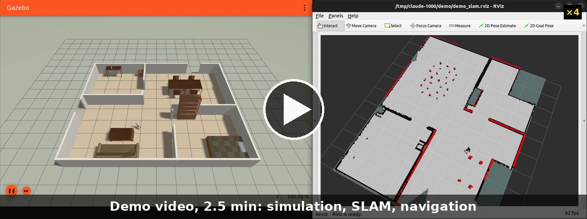
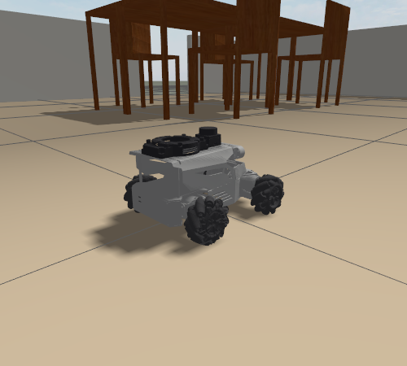
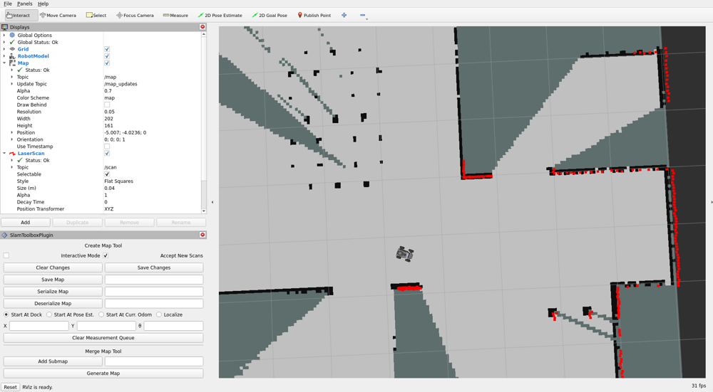

# ROSOrin Autonomy Sim

[](https://docs.ros.org/en/humble/)
[](https://releases.ubuntu.com/22.04/)
[](https://gazebosim.org/docs/fortress)
[](LICENSE)

Simulation of the **Hiwonder ROSOrin Pro** mecanum robot in Ignition Gazebo, with LiDAR SLAM and autonomous navigation
(Nav2). The robot model is checked against the vendor's hardware documentation, and an optional realism mode gives it
drifting wheel odometry and datasheet sensor noise, as on the real robot.


[](https://github.com/user-attachments/assets/ca965abd-1630-4309-ad32-0469e5534bbb)

**[Demo video](https://github.com/vminh16/rosorin-autonomy-sim/releases/download/v1.0.0/rosorin_demo_en.mp4)**
(3 min 39 s): the real commands, step by step, from starting the simulation to a 7-waypoint mission
(recording scripts: [`tools/demo/`](tools/demo/)).
The written report (setup, results, problems, trade-offs) is [`report/report.md`](report/report.md).

## Highlights

- **Faithful robot model**: 13 tests check the URDF and the drive against the Hiwonder wiki (wheel size, lever arm, sensor
  placement and rates); commanded and achieved velocity match (1.00 forward, sideways and turning); real-time factor 1.0.
- **SLAM**: slam_toolbox maps the furnished house (99.7% of the walls detected), driven by hand or explored
  autonomously by Nav2 on the growing map (7/7 rooms in 112 s).
- **Navigation**: AMCL + NavFn + MPPI on the saved map: 6/6 single goals (the vendor's DWB setup: 5/6), 7/7 and 14/14
  waypoints, final error 0.11 to 0.12 m mean against the true pose.
- **Realism mode** (`realism:=true`): encoder odometry with calibration errors and slip, fused with the IMU by a
  robot_localization EKF as on the real robot; LiDAR and IMU noise from the datasheets. Navigation still reaches 7/7 waypoints.

## Installation

Requirements: **Ubuntu 22.04** (ROS 2 Humble has no packages for 24.04); an NVIDIA GPU is recommended. Do not use a conda
environment (`conda deactivate`; `which python3` must print `/usr/bin/python3`). Platform notes for WSL2 and hybrid-GPU
laptops: [`docs/ENVIRONMENT.md`](docs/ENVIRONMENT.md).

**0. ROS 2 Humble** (once per machine; skip if `ls /opt/ros/humble` already works), from the
[official guide](https://docs.ros.org/en/humble/Installation/Ubuntu-Install-Debs.html):

```bash
sudo apt update && sudo apt install -y locales software-properties-common curl git
sudo locale-gen en_US en_US.UTF-8 && sudo update-locale LC_ALL=en_US.UTF-8 LANG=en_US.UTF-8 && export LANG=en_US.UTF-8
sudo add-apt-repository -y universe
export ROS_APT_SOURCE_VERSION=$(curl -s https://api.github.com/repos/ros-infrastructure/ros-apt-source/releases/latest | grep -F "tag_name" | awk -F\" '{print $4}')
curl -L -o /tmp/ros2-apt-source.deb "https://github.com/ros-infrastructure/ros-apt-source/releases/download/${ROS_APT_SOURCE_VERSION}/ros2-apt-source_${ROS_APT_SOURCE_VERSION}.$(. /etc/os-release && echo $VERSION_CODENAME)_all.deb"
sudo dpkg -i /tmp/ros2-apt-source.deb
sudo apt update && sudo apt install -y ros-humble-desktop ros-dev-tools
sudo rosdep init && rosdep update
```

If the system language is not English (for example Vietnamese), also run
`echo 'export LC_NUMERIC=en_US.UTF-8' >> ~/.bashrc`, so that ROS and Gazebo read `0.08` as a number.

**1-5. The workspace:**

```bash
# 1. Get the code
git clone https://github.com/vminh16/rosorin-autonomy-sim.git
cd rosorin-autonomy-sim

# 2. Install the dependencies: Gazebo + bridge, Nav2, slam_toolbox, robot_localization, teleop, then rosdep
source /opt/ros/humble/setup.bash
./setup.sh

# 3. Build (colcon build --symlink-install)
./build.sh

# 4. Source the workspace: in every new terminal, after every build
source install/setup.bash

# 5. Check: 27 tests, 0 failures, no simulator needed
./test.sh
```

## Usage

One terminal per step, each started with `source /opt/ros/humble/setup.bash && source install/setup.bash` from the repository
root. All commands with their measured results: [`COMMANDS.md`](COMMANDS.md).

**1. Simulation.** Gazebo opens with the robot in the house.

```bash
ros2 launch rosorin_navigation sim.launch.py
```

| Argument | Effect |
|---|---|
| `realism:=true` | drifting encoder odometry + IMU in an EKF (`/odom`), sensor noise from the datasheets; true pose on `/ground_truth/odom` |
| `depth:=true` | RGB-D camera: `/depth_cam/depth/image_raw`, `/depth_cam/points` |
| `world:=empty`, `furniture:=false` | empty world, or the house without furniture |
| `gui:=false` | server only (headless) |
| `x:= y:= yaw:=` | spawn pose |

**2. Drive** (`i` forward, `j`/`l` turn, `Shift+J`/`Shift+L` sideways, `k` stop):

```bash
ros2 run teleop_twist_keyboard teleop_twist_keyboard --ros-args -p speed:=0.25 -p turn:=0.5
```

**3. SLAM.** RViz shows the map as it grows. Either drive through every room by hand (stay inside the house and finish near
the start), or let Nav2 explore it on the growing map:

```bash
ros2 launch rosorin_navigation slam.launch.py
# optional, autonomous mapping:
ros2 launch rosorin_navigation navigation.launch.py slam:=true rviz:=false
ros2 run rosorin_navigation waypoint_follower --ros-args -p localizer:=slam
```

**4. Save the map** (while SLAM runs):

```bash
mkdir -p maps && ros2 run nav2_map_server map_saver_cli -f maps/house --ros-args -p use_sim_time:=true -p map_subscribe_transient_local:=true
```

**5. Navigation** on the saved map (stop SLAM first, keep the simulation running). AMCL starts at the spawn pose. Send a
single goal with "2D Goal Pose" in RViz, or run the goal files (one CSV log per run in `results/nav_runs/`; add
`-p true_pose_topic:=odom` to also log the true pose from Gazebo):

```bash
ros2 launch rosorin_navigation navigation.launch.py                  # maps/house.yaml; other map: map:=<path>.yaml
# multi-point: 7 waypoints through every room, as one route
ros2 run rosorin_navigation waypoint_follower --ros-args -p waypoints_file:=src/rosorin_navigation/config/waypoints.yaml
# single goals: one goal per room, each sent and finished on its own
ros2 run rosorin_navigation waypoint_follower --ros-args -p single_goals:=true \
  -p waypoints_file:=src/rosorin_navigation/config/single_goals.yaml
```

Before a new run, stop the previous one: `pkill -f "ign gazebo"; pkill -x rviz2; pkill -f parameter_bridge`.

## How it works

```
 Ignition Gazebo (robot + house)  <-- /cmd_vel -- teleop / Nav2 controller (MPPI)
   |                                                   ^
   +-- ros_gz_bridge --> /scan /imu /odom /tf /clock   |
         |                                          Nav2: AMCL, NavFn, costmaps <-- waypoint_follower
         |  realism:=true: /joint_states --> wheel_odometry --> /odom_raw --+
         |                 /imu ------------------------------------------- EKF --> /odom
         +--> slam_toolbox --> /map --> maps/house.yaml
```

The vendor simulation is kept unmodified in `src/simulations/`. It did not run as published and did not match the real robot,
so every fix lives in a copy in `src/rosorin_navigation/`, and each file states what it changed and why.

## Results

| Metric | Value |
|---|---|
| Real-time factor, house + SLAM + RViz | 1.00 (vendor launch: 0.50) |
| `/scan` / `/odom` / `/imu` / camera | 10 Hz / 50 Hz / 50 Hz / 12 Hz |
| Achieved / commanded velocity (forward, sideways, turning) | 1.00 / 1.00 / 1.00 |
| Single goals in 6 rooms (MPPI / vendor DWB) | 6/6 / 5/6 |
| Waypoint missions | 7/7 (`waypoints.yaml`, 34 m), 14/14 (`waypoints_extended.yaml`, 58.5 m) |
| Final position error, true pose (single goals / waypoints) | 0.11 m / 0.12 m mean |
| Realism mode: odometry drift after a 1 m square (wheels / EKF) | 1.8 cm, 3.0° / 0.8 cm, 1.3° |
| Realism mode: 7-waypoint mission | 7/7, 0.17 m mean error (one run) |

Logs: [`results/nav_runs/`](results/nav_runs/), one CSV per run, one row per goal.

| Gazebo close-up | SLAM in RViz |
|---|---|
|  |  |

## Simulator fidelity

| | Real ROSOrin Pro (wiki) | Simulation |
|---|---|---|
| Body | mecanum chassis, 6-DOF arm, 7-inch screen | vendor CAD chassis; arm (fixed pose) and screen drawn from the photo, visual only |
| LiDAR | COIN-D6, 360°, 10 Hz, 12 m, ±4 mm (< 2 m) / ±15 mm | 360°, 400 beams, 10 Hz, 12 m; noise by range with `realism:=true` |
| Camera | Aurora930 on the wrist, 640x400, 12 fps, depth 0.15-3 m | same mount, size and rate; depth and point cloud with `depth:=true` |
| Odometry | encoders + IMU in a robot_localization EKF, drifts | true pose by default; the real pipeline with `realism:=true` |
| Drive | mecanum, wheel diameter 0.08 m, motors 110 rpm | same constants; traction-limited body drive, top speed 0.461 m/s |

Not modelled: individual mecanum rollers, motor latency, a moving arm, the IR stream. LiDAR-based work transfers best to the
real robot; camera-based work the least. Reasons and evidence: [report, section 5](report/report.md).

```bash
python3 -m pytest src/rosorin_navigation/test/test_sim_fidelity.py -q   # URDF against the wiki
python3 tools/probe_motion.py --speed 0.2 --turn 0.5                     # with a running simulation: ratios 1.00
```

## Repository layout

```
src/simulations/            Hiwonder ROSOrin Pro simulation, unmodified
src/rosorin_gazebo_plugins/ traction-limited drive (Gazebo system plugin, C++)
src/rosorin_navigation/     this project: launch files, fixed robot model, world, Nav2/EKF config,
                            waypoint_follower, realism nodes (wheel_odometry, scan_noise), tests
tools/                      motion, collision and physics probes against Gazebo ground truth;
                            demo/: scripts that recorded the demo video
maps/  results/             saved maps, navigation run logs
report/  docs/              report; environment setup, debug log, images
```

## Troubleshooting

| Symptom | Fix |
|---|---|
| `Package 'rosorin_navigation' not found`, or the robot does not move | `source install/setup.bash` in this terminal, restart the simulation |
| Odd build errors, `layout 'merged'`, `No module named 'catkin_pkg'` | `conda deactivate`, then a [clean rebuild](docs/ENVIRONMENT.md#clean-rebuild) |
| `realism:=true needs robot_localization` | `./setup.sh` |
| Robot fails to spawn, `Invalid frame ID "odom"` | an old simulation is still running: stop it (see Usage) and wait for the robot before Nav2 |
| Map is huge and mostly unknown | the robot left the house through a wall opening: restart and keep it inside |
| Black or crashing Gazebo on WSL2 | handled by `sim.launch.py`; see [platform notes](docs/ENVIRONMENT.md#platform-notes) |

Every problem met during the project, with cause and fix: [`docs/DEBUG_LOG.md`](docs/DEBUG_LOG.md). Changes:
[`CHANGELOGS.md`](CHANGELOGS.md).

## Acknowledgements

- [Hiwonder ROSOrin Pro documentation](https://wiki.hiwonder.com/projects/rosorin-pro/en/latest/): robot model and simulation packages
- [Nav2](https://docs.nav2.org/), [slam_toolbox](https://github.com/SteveMacenski/slam_toolbox), [robot_localization](https://docs.ros.org/en/humble/p/robot_localization/)
- [athackst/vscode_ros2_workspace](https://github.com/athackst/vscode_ros2_workspace): workspace template

## License

Own code: [Apache 2.0](LICENSE). `src/simulations/` is © Hiwonder, redistributed as published on their wiki.
