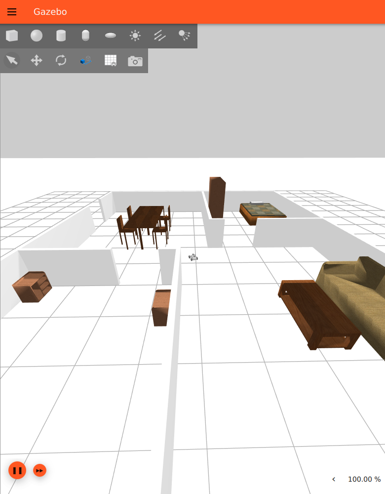
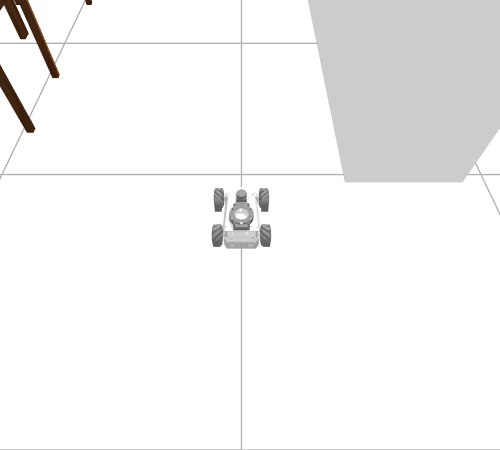
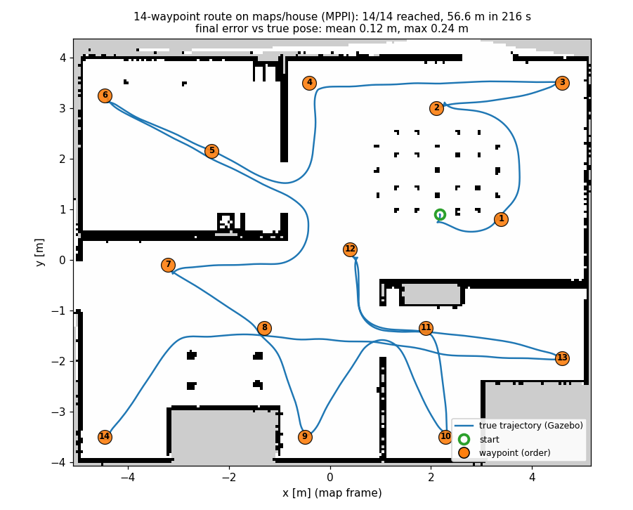

# ROSOrin Autonomy Sim

Simulation of the **Hiwonder ROSOrin Pro** mecanum robot in Ignition Gazebo (Fortress), with LiDAR SLAM and autonomous
navigation (Nav2). ROS 2 Humble, Ubuntu 22.04.



| Part | Status |
|---|---|
| Simulation of the robot, checked against the vendor documentation | done: 13/13 fidelity tests, real-time factor 1.0 |
| Teleoperation, LiDAR in RViz | done |
| SLAM and map saving | done: `maps/house`, 99.7% of the walls detected |
| Nav2 on the saved map, single goal, multi-waypoint missions | done: MPPI controller, 6/6 single goals, 28/28 waypoints |
| Report | done: [`report/report.md`](report/report.md) |
| Demo video | pending |

The short report (setup, results, problems and solutions, trade-offs) is [`report/report.md`](report/report.md).

## How it works

```
 Ignition Gazebo (robot + world)
   |  ign topics --> ros_gz_bridge --> /scan /odom /imu /tf /joint_states /clock /depth_cam/*
   ^
   |  /controller/cmd_vel (bridged from ROS /cmd_vel)
   |
 teleop / Nav2 controller <-- Nav2 (AMCL, planner, controller, costmaps) <-- rosorin_navigation (waypoints)
                                    ^
 SLAM (slam_toolbox) -- map->odom --+--> maps/<name>.yaml
```

The vendor simulation package is vendored unmodified in `src/simulations/`. It did not run as published and did not match the
real robot, so every fix lives in a copy inside `src/rosorin_navigation/` (each file states what it changed and why).

## Getting started

Requirements: Ubuntu 22.04, ROS 2 Humble, a discrete GPU is recommended. Full instructions, package list and platform notes
(including WSL2): [`docs/ENVIRONMENT.md`](docs/ENVIRONMENT.md).

```bash
git clone https://github.com/vminh16/rosorin-autonomy-sim.git ~/research/rosorin-autonomy-sim
cd ~/research/rosorin-autonomy-sim
source /opt/ros/humble/setup.bash      # ROS 2 Humble installed first, see docs/ENVIRONMENT.md
./setup.sh                             # rosdep: installs the dependencies declared in the package.xml files
colcon build --symlink-install
```

## Usage

Open one terminal per stage; in each run `source /opt/ros/humble/setup.bash && source install/setup.bash` from the repository
root, and start a stage only after the previous one is up. The verified, dated commands are in [`COMMANDS.md`](COMMANDS.md).

**0. Clean up a previous run** (a stale simulator makes the new robot fail to spawn):

```bash
pkill -f "ign gazebo"; pkill -x rviz2; pkill -f slam_toolbox
pkill -f parameter_bridge; pkill -f teleop_twist_keyboard
ps -eo pid,args | grep -E "ign|rviz2|slam_toolbox|parameter_bridge|teleop" | grep -v grep   # must print nothing
```

**1. Simulation**: the Gazebo window opens and the robot spawns at the centre of the house.

```bash
ros2 launch rosorin_navigation sim.launch.py                 # furnished house (default)
ros2 launch rosorin_navigation sim.launch.py world:=empty    # empty world
```

Useful arguments: `furniture:=false`, `camera:=false` (do not bridge the RGB camera), `gui:=false` (server only),
`x:= y:= yaw:=` (spawn pose). Check the simulator is healthy (real-time factor about 1.0 with nothing else running):

```bash
ign topic -e -t /stats -n 30 | grep real_time_factor
```

**2. Teleop**: `i` forward, `j`/`l` turn, `k` stop, `Shift+J`/`Shift+L` strafe. Start slowly: scan matching degrades at high
speed (defaults are 0.5 m/s and 1.0 rad/s, and `z` lowers both by 10%).

```bash
ros2 run teleop_twist_keyboard teleop_twist_keyboard --ros-args -p speed:=0.25 -p turn:=0.5
```

**3. LiDAR**: `ros2 topic hz /scan` (about 10 Hz, 400 beams over 360 degrees).

**4. SLAM**: opens RViz with the map growing.

```bash
ros2 launch rosorin_navigation slam.launch.py
```

Drive slowly through every room, **stay inside the house**, and finish near the start pose so that SLAM can close the loop. The
outer wall has two openings (top wall around x = 2.55 to 3.63, left wall around y = -1.06 to -0.01) and the ground plane is 100 x 100 m
with no fence: if the robot leaves through them, the saved map grows to tens of metres of unknown space. If that happens, stop SLAM,
restart `sim.launch.py` and start again.

**5. Save the map** (while SLAM is still running):

```bash
mkdir -p maps && ros2 run nav2_map_server map_saver_cli -f maps/house --ros-args -p use_sim_time:=true -p map_subscribe_transient_local:=true
```

A clean map of the house is about 203 x 163 cells at 0.05 m (about 10 x 8 m). Hiwonder's reference map is
`src/simulations/robot_gazebo/maps/map_01.yaml`.

**6. Navigation** on the saved map (stop SLAM first; the simulation keeps running). It starts map_server with `maps/house.yaml`,
AMCL at the spawn pose (no "2D Pose Estimate" needed if the robot has not moved since `sim.launch.py`) and Nav2 with the MPPI
controller, plus RViz (`rviz:=false` to skip it):

```bash
ros2 launch rosorin_navigation navigation.launch.py
```

Single goal: "2D Goal Pose" in RViz. Multi-waypoint mission: the poses in `src/rosorin_navigation/config/waypoints.yaml`
(x, y, yaw in the `map` frame; 7 points through every room, ending at the start pose):

```bash
ros2 run rosorin_navigation waypoint_follower --ros-args -p waypoints_file:=src/rosorin_navigation/config/waypoints.yaml
```

Each run writes `results/nav_runs/<timestamp>.csv`, one row per waypoint: start and end (sim time), `SUCCEEDED`/`FAILED`,
distance driven, final pose and its error from the waypoint (as estimated by AMCL). Other parameters: `output_dir`, `timeout`
(whole route, default 900 s), `set_initial_pose` with `initial_x`, `initial_y`, `initial_yaw`. A waypoint inside an obstacle is
reached at the nearest free cell up to 0.5 m away (planner tolerance) and still counts as `SUCCEEDED`; check `error_xy_m`.

Controller: the vendor parameters use DWB, which stalls when the path makes a U-turn around a wall inside the local window
(`docs/DEBUG_LOG.md` ISSUE-018); the real robot uses TEB, which has no Humble binary. MPPI is used instead, with the vendor's
limits (0.4 m/s, 1.0 rad/s) and no sideways motion.

## Simulator fidelity and trade-offs

The simulated robot is checked against the Hiwonder wiki (hardware chapter 1.10, kinematics code in chapter 2.2).

| | Real ROSOrin Pro (wiki) | Simulation |
|---|---|---|
| LiDAR | COIN-D6, 360 deg, 0.9 deg, 10 Hz, 12 m | 360 deg, 400 beams, 10 Hz, 12 m |
| Camera | Aurora930, 640x400, 74x51 deg, 12 fps | RGB only, 640x400, 74 deg, 12 Hz (no depth/IR) |
| IMU | `/imu`, frame `imu_link` | `/imu` 49.5 Hz, frame `imu_link` |
| Wheels | mecanum, diameter 0.08 m, lever arm 0.1744 m | same constants in the drive plugin |
| Motion | wheel controller tracks `/controller/cmd_vel`; motors 110 rpm no-load | traction-limited drive plugin: 1.00 forward / sideways / turning; top speed 0.461 m/s, 2.64 rad/s (motor limit); stays flat when pushed into obstacles |
| Odometry | encoders + EKF, drifts | true pose from Gazebo, no drift |
| Mass | not in the wiki (retail: about 3.1 kg) | about 3.1 kg |

```bash
python3 -m pytest src/rosorin_navigation/test/test_sim_fidelity.py -q    # URDF against the wiki, no simulator needed
python3 tools/probe_motion.py --speed 0.2 --turn 0.5                      # needs a running simulation, ratios should be 1.00
python3 tools/probe_collision.py                                          # furnished house: drives into obstacles, all PASS
python3 tools/probe_physics.py                                            # empty world: rest, IMU, step, stop, top speed
```

This is a coursework simulator, not a digital twin. Known and accepted simplifications: idealised actuation (0.1 s response and a
traction limit, but no latency or wheel slip), true odometry, simple LiDAR noise, an RGB-only camera mounted on the chassis, a clean static world, and no
individual mecanum rollers (directional-friction wheels were unstable in Fortress). LiDAR-based inputs transfer best to the real
robot; image-based inputs have the largest gap. Reasons, evidence and consequences are discussed in the report.

## Results

| Metric | Value |
|---|---|
| Gazebo real-time factor, `robocup_home` + SLAM + RViz | 1.00 (was 0.50 with the upstream launch) |
| `/scan` / `/odom` / `/imu` / camera rate | 10 Hz / 50 Hz / 50 Hz / 12 Hz |
| Physics step | 10 ms (upstream 30 ms) |
| RViz frame rate during SLAM | about 57 fps (upstream config about 31 fps) |
| Achieved / commanded velocity (forward, sideways, turning) | 1.00 / 1.00 / 1.00 |
| Single goals, 6 rooms (MPPI / vendor DWB) | 6/6 / 5/6 |
| Final position error, true pose from Gazebo (MPPI) | mean 0.11 m, max 0.18 m; heading 10-14 deg (goal tolerance 0.25 m, 0.25 rad) |
| AMCL error at the goal (MPPI) | mean 0.06 m, max 0.11 m, heading within 2.3 deg |
| Waypoints, `waypoints.yaml` (2 laps of 7) | 14/14; mean 16.0 s per waypoint, 112 s per lap of 31 m |
| Waypoints, `waypoints_extended.yaml` (14, GUI + RViz) | 14/14; 56.6 m in 216 s; final error 0.12 m mean, 0.24 m max (true pose) |

| Gazebo close-up | SLAM in RViz |
|---|---|
|  |  |



Demo video: _pending_.

## Repository layout

```
src/
  simulations/             # Hiwonder ROSOrin Pro simulation, vendored unmodified (robot_gazebo, rosorin_description)
  rosorin_gazebo_plugins/  # PlanarDrive: traction-limited drive for the robot body (Gazebo system plugin, C++)
  rosorin_navigation/      # this project's package
    rosorin_navigation/    #   waypoint_follower.py (nav2_simple_commander, CSV log per run)
    launch/                #   sim.launch.py (Gazebo + robot + bridge), slam.launch.py (slam_toolbox + RViz),
                           #   navigation.launch.py (map_server + AMCL + Nav2 + RViz)
    urdf/                  #   fixed copy of the Hiwonder robot model (wheels, LiDAR, camera, IMU, drive)
    worlds/                #   house world with a 10 ms physics step
    config/                #   nav2_params.yaml (MPPI), waypoints.yaml, wiki_reference.yaml (real-robot values for the tests)
    rviz/                  #   SLAM and Nav2 views
    test/                  #   fidelity tests (URDF against the wiki) and lint
tools/probe_motion.py      # commanded versus achieved velocity from Gazebo ground truth
tools/probe_collision.py   # drives into walls and furniture, checks the robot stays flat
maps/                      # saved maps
results/nav_runs/          # navigation run logs (CSV)
report/                    # written report
docs/                      # ENVIRONMENT.md, DEBUG_LOG.md, images
COMMANDS.md  CHANGELOGS.md
```

## Troubleshooting

| Symptom | Cause | Fix |
|---|---|---|
| `package 'holonomic_sim' not found` | bug in the Hiwonder `worlds.launch.py` / `room_worlds.launch.py` | use `rosorin_navigation sim.launch.py` |
| Robot does not move at the commanded speed, cannot strafe | wrong drive constants in the Hiwonder URDF (ISSUE-013) | use the fixed URDF (default in `sim.launch.py`) |
| Robot does not move at all, `/odom` silent or static | the drive plugin was not found: workspace not sourced after a build | `source install/setup.bash` (sets `IGN_GAZEBO_SYSTEM_PLUGIN_PATH`), restart the simulation |
| Robot climbs furniture, flips or flies away | old velocity-override drive (ISSUE-016) | rebuild: `colcon build --symlink-install`, then source again |
| Map jumps or TF warnings with SLAM or AMCL | the Hiwonder bridge always publishes a static `map->odom` | off by default in `sim.launch.py` |
| Real-time factor around 0.5 in `robocup_home` | upstream furniture spawned as dynamic bodies, 30 ms step | static furniture and a 10 ms step (ISSUE-012) |
| `Invalid frame ID "odom"` | the robot has not spawned yet | look at the Gazebo terminal before Nav2 |
| Robot turns back and forth in place, `Failed to make progress` (DWB) | vendor DWB critics on a U-shaped path (ISSUE-018) | use `config/nav2_params.yaml` of this package (MPPI) |
| Map is huge and mostly unknown | the robot left the house through the wall openings | restart the simulation, keep the robot inside |
| RViz smeared while driving (Nav2 view) | AMCL particle cloud redrawn each frame | `rviz2 -d src/rosorin_navigation/rviz/nav2_clean.rviz --ros-args -p use_sim_time:=true` |
| Gazebo aborts with `OGRE EXCEPTION ... GL3PlusTextureGpu::copyTo`, or furniture is black (Mesa D3D12, e.g. WSL2) | Mesa reports OpenGL 4.2; ogre2 GUI problem | handled by `sim.launch.py` (`MESA_GL_VERSION_OVERRIDE=4.5`, GUI engine `ogre`) |

All problems met, with causes and fixes: [`docs/DEBUG_LOG.md`](docs/DEBUG_LOG.md). Release notes: [`CHANGELOGS.md`](CHANGELOGS.md).

## Acknowledgements

- [Hiwonder ROSOrin Pro documentation](https://wiki.hiwonder.com/projects/rosorin-pro/en/latest/): robot model and simulation packages
- [Nav2](https://docs.nav2.org/) and the `nav2_simple_commander` examples
- [athackst/vscode_ros2_workspace](https://github.com/athackst/vscode_ros2_workspace): workspace template

## License

Own code: see [`LICENSE`](LICENSE). `src/simulations/` is (c) Hiwonder, redistributed as published on their wiki.
