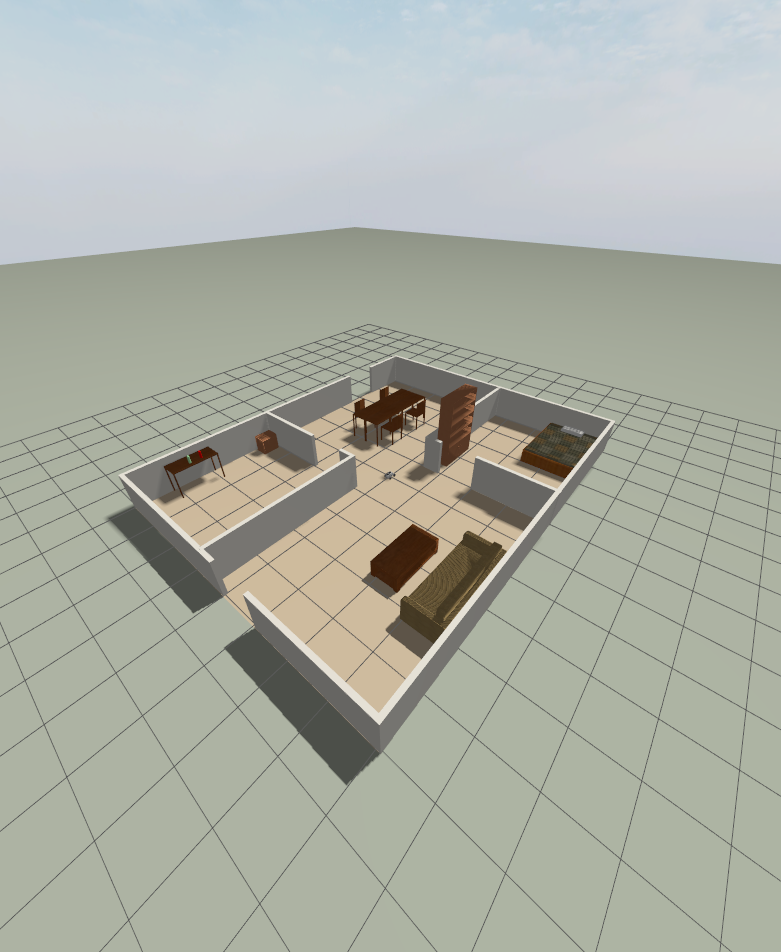

# Part 1 Report: ROSOrin Pro Simulation, SLAM and Navigation

**Robot:** Hiwonder ROSOrin Pro, a small four-wheel mecanum robot with a 360° 2D LiDAR.
**Software:** Ignition Gazebo 6 (Fortress), ROS 2 Humble, Ubuntu 22.04. **GPU:** NVIDIA RTX 2050.
**Repository:** `vminh16/rosorin-autonomy-sim`; short hashes such as `4d85581` point to the commit with the change and its
evidence. **Demo video:** [3 min 39 s](https://github.com/vminh16/rosorin-autonomy-sim/releases/download/v1.0.0/rosorin_demo_en.mp4).

## 1. Summary

- The whole Part 1 pipeline works in simulation: drive the robot, see the LiDAR, build and save a map with SLAM, and navigate
  on it with Nav2, to a single goal or through a list of waypoints.
- The vendor's simulation did not start as published, and once it ran, the robot did not behave like the real one: 0.8× the
  commanded speed, no sideways motion, a LiDAR that saw 156° instead of 360°. I fixed it from the vendor's own documentation and
  checked every fix with a measurement.
- **Map:** 99.7% of the walls end up in the saved map, with no offset. Nav2 can also explore the house by itself while the map
  is being built.
- **Navigation:** 6/6 single goals, 7/7 and 14/14 waypoints. The robot stops 0.11 to 0.12 m from the target on average (true
  position from Gazebo). The vendor's DWB controller got stuck on a U-shaped path (5/6); MPPI solves it (6/6).
- **Realism mode** (`realism:=true`): the odometry comes from wheel encoders and drifts, an EKF fuses it with the gyro as on the
  real robot, and the sensors get datasheet noise. Navigation still reaches 7/7 waypoints.

## 2. Setup

| Item | Value |
|---|---|
| Operating system | Ubuntu 22.04.5 (ROS 2 Humble has no packages for 24.04) |
| Simulators | Ignition Gazebo 6.18 for the ROSOrin; Gazebo Classic 11 for a TurtleBot3 baseline |
| ROS packages | slam_toolbox (mapping), Nav2 1.1.20 (localization, planning, control), robot_localization (EKF), ros_gz_bridge |
| Vendor package | Hiwonder `simulations.zip` V1.0.0 (2025-05-29), kept unmodified in `src/simulations/` (`4c21540`) |
| My packages | `rosorin_navigation`: launch files, fixed robot model, world, Nav2 and EKF settings, waypoint follower, tests. `rosorin_gazebo_plugins`: the drive plugin (C++) |
| Rule | Never edit vendor files: copy, fix the copy, and explain the change at the top of it |

```
Gazebo (robot, house, physics)
   LiDAR /scan (10 Hz) -------> slam_toolbox ---> map ---> maps/house.{pgm,yaml}
   odometry /odom ---------------------^                        |
   /cmd_vel <---- Nav2: AMCL (where am I on the map?)  <--------+
                        NavFn (path through the map)
                        MPPI (velocity commands that follow the path)
                           ^
                 goals: RViz "2D Goal Pose" or the waypoint follower

realism:=true replaces the two inputs on the left, as on the real robot (wiki 2.1.4):
   wheel encoders -> /odom_raw --+--> EKF (robot_localization) -> /odom
   gyro           -> /imu -------+
   LiDAR          -> /scan_raw ----> datasheet noise -> /scan
```

Before switching to the ROSOrin, I ran the same Nav2 pipeline on the TurtleBot3, so that later failures could be blamed on the
ROSOrin port and not on the tools. Installation is in `README.md`; every tested command, with its date and result, is in
`COMMANDS.md`.



## 3. Results

### 3.1 Simulator

The real-time factor (RTF) is simulated time divided by real time: 1.0 means the simulation keeps up with the clock.

| Check | Result | How |
|---|---|---|
| Real-time factor | 1.000 headless with all furniture; 0.996 with Gazebo GUI, Nav2 and RViz | `ign topic -e -t /stats` |
| Sensor rates `/scan`, `/odom`, `/imu`, camera | 9.95, 50, 49.5, 12.05 Hz | `ros2 topic hz` |
| Robot model against the vendor documentation | 13/13 tests pass | `test_sim_fidelity.py` |
| Achieved / commanded speed (forward, sideways, turning) | 1.00, 1.00, 1.00 | `tools/probe_motion.py` |
| Driving into walls and furniture at full speed | 9/9: the robot stays flat | `tools/probe_collision.py` |
| Rest, start, stop, top speed | 7/7 | `tools/probe_physics.py` |
| All package tests and style checks | 27 tests, 0 failures | `./test.sh` |
| Realism mode: drift after driving a 1 m square | wheel odometry 1.8 cm and 3.0°; EKF 0.8 cm and 1.3° | against the true position |

### 3.2 Map

| | |
|---|---|
| Size | 205 × 169 cells of 0.05 m (about 10 × 8.5 m); the vendor's reference map is 203 × 163 |
| Walls found | 99.7% of the walls in the world file appear in the map |
| Accuracy | 80% of the occupied cells lie within 0.1 m of a real wall (the rest is furniture); no global shift |
| Files | `maps/house.pgm`, `maps/house.yaml` (`0169f4a`) |
| Autonomous mapping | Nav2 drives through the 7 rooms on the map SLAM is still building: 7/7 in 112 s, twice (`002d605`). This is the mapping shown in the video |

| Saved map | SLAM in progress |
|---|---|
|  |  |

### 3.3 Navigation

Nav2 runs on the saved map with AMCL, NavFn and MPPI, at most 0.4 m/s and 1.0 rad/s, forward and turning only. "Final error"
is the distance between the target and where the robot stopped, measured against its true position in Gazebo. The first
three columns come from one session on the current robot model; each CSV in `results/nav_runs/` has one row per goal.

| | Single goals | Short route | Long route | Short route, realism mode |
|---|---|---|---|---|
| Route | 6 goals, one per room, each sent on its own | 7 waypoints through every room | 14 waypoints over every room and corner | the same 7 waypoints |
| Reached | **6/6** (vendor DWB: 5/6) | **7/7** | **14/14** | **7/7** |
| Time | 15.9 s per goal (11.1 to 28.9 s) | 17.0 s per waypoint, 34 m in 119 s | 15.4 s per waypoint, 58.5 m in 215 s | 16.1 s per waypoint |
| Final error | **0.11 m** mean, 0.17 m worst | **0.12 m** mean, 0.27 m worst | **0.12 m** mean, 0.23 m worst | 0.17 m mean, 0.25 m worst (AMCL estimate) |
| Heading error | 14° mean, 15° worst | 11° mean, 12° worst | 10° mean, 13° worst | — |
| AMCL against true position | 0.09 m mean, 0.16 m worst | 0.08 m mean, 0.14 m worst | 0.07 m mean, 0.15 m worst | — |
| Log | `20261014-120611.csv` | `20261014-120750.csv` | `20261014-120952.csv` | `COMMANDS.md` |


What the numbers mean:

- A goal counts as reached within 0.25 m and 0.25 rad of where AMCL thinks the robot is, and the robot stops at once. The
  final errors therefore sit just under those limits, and can pass them by the AMCL error (0.27 m once). Tighter limits
  would give smaller errors but a slower final approach.
- A waypoint inside an obstacle is still "reached": the planner moves it to the nearest free cell, up to 0.5 m away. The CSV
  log therefore also stores the real distance to the requested point.
- By default the odometry does not drift, so these errors are a best case. With drift (realism mode) the route is still
  completed and the error grows only slightly; with a single run, this shows the pipeline copes with drift, not by how much
  it is worse.

## 4. Problems and solutions

Only problems that would have broken the system, or made the results silently wrong. Smaller issues are in
`docs/DEBUG_LOG.md`.

| # | What went wrong | Cause (verified) | Fix and result | Commit |
|---|---|---|---|---|
| 1 | The vendor's launch files do not start | They ask for a package (`holonomic_sim`) that is not shipped and start a `ros2_control` node the robot model does not support | My own launch file with only the nodes that are needed | `e790523` |
| 2 | The robot drives at 0.80× the commanded speed, cannot move sideways and turns erratically. Every navigation result would be wrong, with no error shown | The drive plugin uses a wheel radius of 0.05 m (real 0.04 m) and a lever arm of 0.32 m (real 0.1744 m); high wheel friction blocks sideways sliding | Constants from the vendor's kinematics code (wiki 2.2.2.4): 1.00, 1.00, 1.00 | `4d85581` |
| 3 | The sensors differ from the real robot | LiDAR 156° with 270 beams (real 360°, 400); IMU never publishes; camera 60° at 30 Hz (real 74° at 12 fps). The model is the plain ROSOrin: no arm, camera on the chassis instead of the Pro's wrist | Documented values, guarded by `test_sim_fidelity.py`; camera moved to the wrist, arm and screen drawn from the photo | `4d85581`, `160663e` |
| 4 | The map jumps, coordinate frames conflict | The vendor's bridge always publishes a fixed `map→odom`, which is exactly what SLAM and AMCL must publish | Made optional, off by default | `e790523` |
| 5 | The simulation runs at half speed (RTF 0.50) | The 17 pieces of furniture are movable bodies stacked on each other. My first guess (camera rendering) was wrong; measuring 8 variants found the cause | Static furniture, 10 ms physics step: RTF 1.00 | `5881e17` |
| 6 | During mapping the robot climbed furniture, flipped and flew 56 m high, ruining the map | My first drive model forced the commanded velocity with unlimited force | New drive plugin `PlanarDrive`, whose push is limited by wheel friction as on the real robot: collision test 5/9 → 9/9, worst tilt 41° → 0.6° | `79aeecc` |
| 7 | The robot reached 1.0 m/s and 5 rad/s, faster than its motors allow | No wheel speed limit. The real motors turn at most 110 rpm: 0.461 m/s and 2.64 rad/s | Motor limit added: `probe_physics.py` 7/7 | `6916228` |
| 8 | The vendor's Nav2 settings cannot be used as published | Footprint of radius 0.07 m for a body that reaches 0.177 m, so paths lead through gaps the robot does not fit; no simulation time; mismatched speed limits; the controller file the launch needs is missing | Fixed copy: real rectangular footprint, simulation time, consistent limits | `2484e5d` |
| 9 | With DWB, one goal fails 3 times out of 3: the robot wiggles in place until Nav2 gives up | Nothing blocks the robot; DWB itself commands zero speed. The path makes a U-turn around a wall inside the controller's 2 m window, and two of DWB's scores (towards the goal, along the path) cancel out. Confirmed from DWB's published scores | MPPI instead of DWB: 6/6, the hard goal in 29 s (`results/nav_runs/20261014-120611.csv`) | `2484e5d` |
| 10 | In realism mode the EKF lost about 1° of heading on every 90° turn, although the gyro and the wheel odometry were both right | In the simulation the wheels stop at once, but the body coasts for 0.1 s. The wheel odometry then reports "stopped" with the real driver's tiny covariance, and the EKF trusts it over the gyro | Report "stopped" only after 0.3 s without wheel motion: the EKF stays within 0.15° of the gyro | `756c67e` |

## 5. Trade-offs

A simulator cannot copy the real world, and a perfect copy would not help: it would be slow to build and run, and still wrong in
some detail. The rule I used for every decision: **copy what the navigation stack (or a later learning method) senses and
controls; randomise what is uncertain; skip what it can neither sense nor affect.**

### 5.1 Decisions and their costs

| Decision | Alternative | Why | Accepted cost |
|---|---|---|---|
| A friction-limited force moves the body (`PlanarDrive`); the wheels only spin for show | Real mecanum wheels with direction-dependent friction | 8 friction variants, 3 runs each, including Gazebo's official mecanum example: sideways speed ranged from 0.00 to 0.77 of the command. Unstable | No wheel slip; friction (0.6) and response time (0.1 s) are assumptions |
| 360° LiDAR with 400 beams, as in the hardware manual | The vendor's 156° | The hardware page says 360° | If the real driver crops the scan, SLAM is easier here |
| True-position odometry by default; drifting encoder odometry + EKF with `realism:=true` | Always drift | Results stay reproducible; drift is one switch away | Drift values are guesses inside the vendor's calibration tolerances (3 cm per metre, 1.5° per turn); sideways slip is not documented at all |
| Static furniture | Movable furniture | RTF 0.50 against 1.00 | The robot cannot push objects |
| MPPI, forward and turning only | DWB (vendor) or TEB (the real robot) | DWB: 5/6 (problem 9). TEB has no ROS 2 Humble package | Not the real robot's controller; sideways motion unused |
| Arm and screen drawn from the product photo, in one fixed pose | No arm, or a working 6-joint arm | No CAD or link lengths published; lengths estimated from the photo (±1 cm) | The arm cannot grasp, and the wrist camera does not move |

### 5.2 Guesses that turned out wrong

| Guess | Test | Outcome |
|---|---|---|
| The simulation is slow because of camera rendering | RTF of 8 variants | Wrong: the movable furniture |
| `/odom` matches the true position, so the drive is right | Commanded against achieved speed | Wrong: `/odom` *was* the true position, which hid the 0.8× error |
| Forcing the commanded velocity is a safe stand-in for wheels | Free driving, a crash into a wall | Wrong: pressed against furniture, the robot climbs and flies off |
| DWB stops because something blocks the robot | Logged commands and true position | Wrong: DWB itself commands zero speed |

### 5.3 What this means for learning methods later

The simulator should later produce data for learned models or policies, so the gap to the real robot matters. This is a
judgement: nothing was measured on the real robot yet.

| Gap | Effect | How to reduce it |
|---|---|---|
| Ideal motors: no delay or slip measured on the robot | A learned policy may command faster changes than the robot can follow; the largest gap for navigation | Random command delay and lag; calibrate with the vendor's 1 m and 360° tests |
| Odometry drift only in realism mode | A method trained without it never learns to handle drift | Train with `realism:=true` and randomise the drift values |
| Clean, static world; arm and camera in one pose | Largest gap for image-based methods | Random textures, furniture and arm poses |

LiDAR-based inputs should transfer best and images worst. Before trusting a result: train in this simulator, test in a version
with extra delay and noise, and see how much the performance drops.

## 6. References

- Hiwonder ROSOrin Pro documentation: <https://wiki.hiwonder.com/projects/rosorin-pro/en/latest/>, and the Aurora930 camera wiki.
- Nav2 (MPPI controller, `nav2_simple_commander`), slam_toolbox, robot_localization documentation.
- QST QMI8658A/C datasheets (gyroscope noise 13 to 15 mdps/√Hz), for the IMU noise in realism mode.
- Gazebo Sim `mecanum_drive.sdf` example; ros_controllers pull request 149 (mecanum wheels in Gazebo).
- The wiki was read with the help of an LLM. Every number that changed the robot model is traced to a wiki section in
  `src/rosorin_navigation/config/wiki_reference.yaml`, and was then checked by a test or a measurement.
