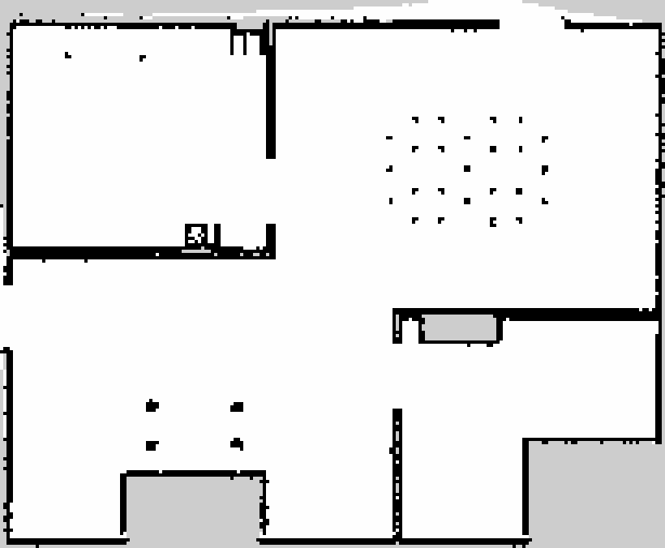

# Part 1 Report: ROSOrin Pro Simulation, SLAM and Navigation

**Robot:** Hiwonder ROSOrin Pro, a small four-wheel mecanum robot with a 360° 2D LiDAR.
**Software:** Ignition Gazebo 6 (Fortress), ROS 2 Humble, Ubuntu 22.04. **GPU:** NVIDIA RTX 2050.
**Repository:** `vminh16/rosorin-autonomy-sim`. The short hashes (for example `4d85581`) point to the commit that contains each
change and its evidence.

## 1. Summary

- The full Part 1 pipeline works in simulation: drive the robot, show the LiDAR, build a map with SLAM, save it, and navigate
  on it with Nav2, both to a single goal and through a list of waypoints.
- The vendor's simulation package did not start as published. Once it ran, the robot did not behave like the real one: it drove
  at 0.8× the commanded speed, could not move sideways, and its LiDAR saw only 156° instead of 360°. I fixed the simulator using
  the vendor's own documentation and checked every fix with a measurement.
- **Map:** 99.7% of the walls of the world are in the saved map, with no offset.
- **Navigation:** 6/6 single goals, and 28/28 waypoints in three runs of two routes. The robot stops on average 0.11 to 0.12 m from the
  target, measured against its true position in Gazebo.
- The vendor's navigation settings use the DWB controller, which got stuck in front of a U-shaped path (5/6 goals). I replaced
  it with the MPPI controller (6/6).

## 2. Setup

| Item | Value |
|---|---|
| Operating system | Ubuntu 22.04.5 (ROS 2 Humble has no packages for 24.04) |
| Simulators | Ignition Gazebo 6.18 for the ROSOrin; Gazebo Classic 11 for a TurtleBot3 baseline |
| ROS packages | slam_toolbox (mapping), Nav2 1.1.20 (localization, planning, control), ros_gz_bridge, nav2_simple_commander |
| Vendor package | Hiwonder `simulations.zip` V1.0.0 (2025-05-29), kept unmodified in `src/simulations/` (`4c21540`) |
| My packages | `rosorin_navigation`: launch files, fixed robot model, world, Nav2 settings, waypoint follower, tests. `rosorin_gazebo_plugins`: the drive plugin (C++) |
| Rule | Never edit vendor files: copy the file, fix the copy, and explain the change at the top of it |

How the parts connect:

```
Gazebo (robot, house, physics)
   LiDAR /scan (10 Hz) -------> slam_toolbox ---> map ---> maps/house.{pgm,yaml}
   odometry /odom ---------------------^                        |
   /cmd_vel <---- Nav2: AMCL (where am I on the map?)  <--------+
                        NavFn (path through the map)
                        MPPI (velocity commands that follow the path)
                           ^
                 goals: RViz "2D Goal Pose" or the waypoint follower
```

Before using the ROSOrin, I ran the same Nav2 pipeline on the TurtleBot3, so that later failures could be blamed on the ROSOrin
port and not on the tools. Install and run commands are in `README.md`; every command that was tested, with its date and
result, is in `COMMANDS.md`.


## 3. Results

### 3.1 Simulator

The real-time factor (RTF) is simulated time divided by real time; 1.0 means the simulation keeps up with the clock.

| Check | Result | How it was measured |
|---|---|---|
| Real-time factor | 1.000 without GUI and with all furniture; 0.996 with Gazebo GUI, Nav2 and RViz | `ign topic -e -t /stats` |
| Sensor rates `/scan`, `/odom`, `/imu`, camera | 9.95, 50, 49.5, 12.05 Hz | `ros2 topic hz` |
| Robot model against the vendor documentation | 13/13 tests pass | `test_sim_fidelity.py` |
| Achieved speed divided by commanded speed (forward, sideways, turning) | 1.00, 1.00, 1.00 | `tools/probe_motion.py` |
| Driving into walls and furniture (1 m/s command, limited to 0.461 m/s by the motor model) | 9/9 cases: the robot stays flat (tilt < 10°, height < 0.05 m) | `tools/probe_collision.py` |
| Rest, start, stop and top speed | 7/7 pass | `tools/probe_physics.py` |
| All package tests and code style checks | 24 tests, 0 failures | `colcon test` |

### 3.2 Map

| | |
|---|---|
| Size | 205 × 169 cells of 0.05 m (about 10.3 × 8.5 m). The vendor's reference map is 203 × 163 cells |
| Walls found | 99.7% of the walls in the world file `robocup_home.sdf` appear in the map |
| Accuracy | 80% of the occupied cells are within 0.1 m of a real wall (the rest is furniture); no global shift |
| Files | `maps/house.pgm`, `maps/house.yaml` (`0169f4a`) |

| Saved map | SLAM in progress |
|---|---|
|  |  |

### 3.3 Navigation

Nav2 runs on the saved map with AMCL (localization), NavFn (path planning) and MPPI (control), at most 0.4 m/s and 1.0 rad/s,
forward and turning only. "Final error" is the distance between the target and where the robot stopped. For the single goals
and the 14-waypoint route it is measured against the robot's true position in Gazebo.

| | Single goal | Waypoints, short route | Waypoints, long route |
|---|---|---|---|
| Route | 6 goals, one per room | 7 waypoints through every room, driven twice | 14 waypoints spread over every room and corner |
| Run with | no GUI | no GUI | Gazebo GUI and RViz |
| Reached | **6/6** (vendor DWB: 5/6) | **14/14** | **14/14** |
| Time | 16.4 s per goal on average (11.2 to 31.5 s) | 16.0 s per waypoint; 112 s per lap of about 31 m | 15.4 s per waypoint; 56.6 m in 216 s |
| Final error | **0.11 m** average, 0.18 m worst; heading 10° to 14° | 0.15 m average, 0.24 m worst (AMCL estimate) | **0.12 m** average, 0.24 m worst; heading 9° average, 13° worst |
| Localization error (AMCL against true position) | 0.06 m average, 0.11 m worst | not measured | 0.06 m average, 0.15 m worst |
| Log | — | `results/nav_runs/20261012-155416.csv`, `20261012-155622.csv` | `results/nav_runs/20261012-163320.csv` |


What the numbers mean:

- The robot counts a goal as reached when it is within 0.25 m and 0.25 rad (14.3°) of it, and stops at once. This is why the
  final errors sit just under those limits. Tighter limits give smaller errors but a slower final approach.
- A waypoint placed inside an obstacle is still reported as reached: the planner moves the goal to the nearest free cell, up to
  0.5 m away (0.30 m in my test). The CSV log therefore also stores the real distance to the requested point.
- In this simulation the odometry has no drift, so these errors are a best case for the real robot.

## 4. Problems and solutions

Only the problems that would have broken the system, or made the results wrong without any error message, are listed here.
Smaller issues and errors in the vendor's documentation are in `docs/DEBUG_LOG.md`.

| # | What went wrong | Cause (verified) | Fix and result | Commit |
|---|---|---|---|---|
| 1 | The vendor's launch files fail: missing package, crashing node; the Gazebo window aborts or shows black furniture ([screenshot](../docs/images/gazebo_ogre2_black.png)) | The launch asks for a package `holonomic_sim` that is not shipped; it starts `ros2_control_node` for a robot model that has no `ros2_control` section; the default ogre2 renderer fails with the Mesa graphics driver | My own launch file: older `ogre` renderer for the GUI, OpenGL version override, unused nodes removed | `e790523` |
| 2 | The robot drives at 0.80× the commanded speed, cannot move sideways (0.00 m/s), and turns erratically (0.3 to 1.1 rad/s for a 0.5 rad/s command). Every navigation result would be wrong, with no error shown | The drive plugin uses a wheel radius of 0.05 m (real: 0.04 m) and a lever arm of 0.32 m (real: 0.1744 m); wheel friction 10 blocks sideways sliding | Constants taken from the vendor's kinematics code (wiki 2.2.2.4): 1.00, 1.00, 1.00 | `4d85581` |
| 3 | The sensors differ from the real robot | LiDAR 156° with 270 beams (real: 360°, 400); IMU loaded but never publishes; camera 60° at 30 Hz (real: 74° at 12 fps) | Set to the documented values; `test_sim_fidelity.py` fails if they change | `4d85581` |
| 4 | The map jumps and the coordinate frames conflict | The vendor's bridge always publishes a fixed `map→odom` transform, which is the transform SLAM and AMCL must publish | Made optional (`static_map_tf`, off by default) | `e790523` |
| 5 | The simulation runs at half speed (RTF 0.50) | The 17 pieces of furniture are movable bodies stacked on each other, so the physics engine solves their contacts every step. My first guess (camera rendering) was wrong; measuring 8 variants found the real cause | Furniture spawned as static objects, physics step 10 ms: RTF 1.00 | `5881e17` |
| 6 | During mapping the robot climbed furniture, flipped over and flew to a height of 56 m, ruining the map | My own first drive model (`VelocityControl`) forced the commanded velocity with unlimited force; also, two nodes published `/odom` | New drive plugin `PlanarDrive`: the pushing force is limited by wheel friction, as on the real robot. Collision test 5/9 → 9/9, worst tilt 41° → 0.6° (measured at `79aeecc`) | `79aeecc` |
| 7 | The robot reached 1.0 m/s and 5 rad/s, faster than its motors allow | No limit on wheel speed. The real motors turn at most 110 rpm: 0.461 m/s and 2.64 rad/s | Wheel speed limited to the motor value: `probe_physics.py` 7/7 | `6916228` |
| 8 | The vendor's Nav2 settings cannot be used as published | The robot is described as a circle of radius 0.07 m, while its body reaches 0.177 m from the centre, so paths can lead through gaps it does not fit; the controller does not use simulation time; the velocity smoother cuts speed to 0.26 m/s while the controller plans with 0.4 m/s; the controller file `nav2_controller_teb.yaml` that the launch needs is missing | Fixed copy (`config/nav2_params.yaml`): real rectangular footprint, simulation time everywhere, matching speed limits | `2484e5d` |
| 9 | With DWB, one goal fails 3 times out of 3: the robot turns slightly left and right in place until Nav2 gives up ("Failed to make progress") | The robot is not blocked; the controller itself commands zero forward speed. The path makes a U-turn around a wall, and the whole U fits in the controller's 2 m view. One part of DWB's scoring pulls the robot straight towards the goal (into the wall), another pulls it along the path; the two cancel out. Confirmed from DWB's published trajectory scores | MPPI controller instead of DWB: 6/6, the hard goal is reached in 31.5 s | `2484e5d` |

## 5. Trade-offs

A simulator cannot copy the real world, and a perfect copy would not even help: it would be slow to build and to run, and it
would still be wrong in some detail. The question is which differences are acceptable. The rule I used for every decision:
**copy what the navigation stack (or a later learning method) senses and controls; randomise what is uncertain; skip what it
can neither sense nor affect.**

### 5.1 Decisions and their costs

| Decision | Alternative | Why | Accepted cost |
|---|---|---|---|
| A friction-limited force moves the robot body (`PlanarDrive`); the wheels only spin for show | (a) Real mecanum wheels with direction-dependent friction; (b) forcing the commanded velocity | (a) 8 friction variants, 3 runs each, including Gazebo's official mecanum example: forward motion was exact, but sideways speed ranged from 0.00 to 0.77 of the command and turning from 0.59 to 7.4: unstable. (b) Climbs furniture and flies away (problem 6) | No wheel slip. The friction coefficient (0.6) and response time (0.1 s) are assumptions, not measured on the robot |
| 360° LiDAR with 400 beams, as in the hardware manual | The vendor's 156° | The vendor's hardware page says 360°. The real driver might crop the scan, but the documentation does not say so | If the real robot crops its scan, SLAM is easier here than on the robot |
| `/odom` is the true position from Gazebo | Wheel odometry that drifts | The real robot uses wheel encoders and an EKF filter (wiki 2.1.4) | Localization looks better than it will on the robot |
| Furniture cannot move | Movable furniture | RTF 0.50 against 1.00 | The robot cannot push objects |
| MPPI controller, forward and turning only | DWB (vendor) or TEB (the real robot's default) | DWB: 5/6 goals (problem 9). TEB: no ready-made package for ROS 2 Humble, and the vendor did not publish its TEB settings | A different controller than the real robot; the mecanum wheels' sideways motion is not used |
| RGB camera only, on the body | Add depth and infrared, mount it on the arm's wrist like the real robot | Not needed for Part 1, and expensive to render | Methods that use images see a different view |

### 5.2 Guesses that turned out wrong

Recording the wrong guesses shows how each problem was really found.

| Guess | Test | Outcome |
|---|---|---|
| The simulation is slow because of camera rendering | Measured the RTF of 8 variants | Wrong: the movable furniture was the cause |
| `/odom` matches the true position, so the drive constants are right | Compared commanded and achieved speed | Wrong: `/odom` *is* the true position, so it hid the 0.8× error |
| Forcing the commanded velocity is a safe stand-in for wheels | Free driving, a straight crash into a wall | Wrong: those were only the cases I thought of. Pressed against furniture, the robot climbs and flies off |
| DWB stops because something blocks the robot | Logged the controller's commands and the true position | Wrong: nothing blocks it; the controller itself commands zero speed |
| The LiDAR "scans through walls" | Traced every beam with the robot upright | Wrong: beams leave only through two openings in the outer wall; the effect came from the flipped robot looking over the walls |

### 5.3 What this means for learning methods later

The simulator is meant to produce data for later work (for example a learned world model or policy), so the gap to the real
robot matters. This is a judgement, not a measurement: nothing was measured on the real robot.

| Gap | Effect | How to reduce it |
|---|---|---|
| Ideal motors: 0.1 s response, friction and motor speed limits from the datasheet, but no delay or slip measured on the robot | A policy learned here may command faster changes than the real robot can follow. The largest gap for navigation | Add random delay and lag to the commands; calibrate with the vendor's 1 m and 360° tests |
| Odometry without drift | A method that relies on odometry never learns to handle drift | Add drift and noise |
| LiDAR with simple noise | Small, if training includes noise and missing beams | Noise from the datasheet, random dropouts |
| Clean, static world; camera on the body | Largest gap for image-based methods | Correct camera position, random textures and furniture |

LiDAR-based inputs should transfer best and image-based inputs worst. To measure the gap before trusting a result: train in
this simulator, test in a version with extra delay and noise, and look at how much the performance drops.

**Not done on purpose:** individual mecanum rollers, the 6-joint arm, depth and infrared images, and a motor model calibrated
on the real robot (no real-robot data yet).

## 6. References

- Hiwonder ROSOrin Pro documentation: <https://wiki.hiwonder.com/projects/rosorin-pro/en/latest/>, and the Aurora930 camera wiki.
- Nav2 documentation (MPPI controller, `nav2_simple_commander`); slam_toolbox.
- Gazebo Sim `mecanum_drive.sdf` example; ros_controllers pull request 149 (mecanum wheels in Gazebo).
- The wiki was read with the help of an LLM. Every number that changed the robot model can be traced to a wiki section through
  `src/rosorin_navigation/config/wiki_reference.yaml`, and was then checked by a test or a measurement.
